# Dopamine Research Platform — Technical Overview

> A complete walkthrough of the project: what it does, how it is built, why each
> decision was made, how the code is organized and tested, how the agents are
> wired, how memory works, and what it would take to run this in production
> (including real costs).
>
> Companion documents: [README.md](README.md) (usage),
> [DECISIONS.md](DECISIONS.md) (condensed rationale), and
> [crew/graph/README.md](crew/graph/README.md) (graph usage). This document is
> the long form — it supersedes none of them but explains all three in depth.

The project is **two subsystems over one corpus of nine dopamine papers**:

| | **Part I — Q&A crew** (`crew/`) | **Part II — Scientist GraphRAG** (`crew/graph/`) |
|---|---|---|
| Question it answers | *What do the papers say?* | *Who wrote them, and who should meet whom?* |
| Retrieval substrate | Hybrid FAISS + BM25 over page chunks | A typed knowledge graph of people, papers, institutions, topics |
| Unit of evidence | A passage at `(file, page)` | A node or edge at `(file, page)` |
| Output contract | `CrewResponse` | `GraphAnswer` — deliberately the same shape |

They share the same PDFs, the same embedder, the same SQLite memory store, and
the same discipline: **agents decide, the orchestrator guarantees.** Neither
depends on the other at runtime.

---

## Table of contents

**Part I — the Q&A crew**

1. [What the project is](#1-what-the-project-is)
2. [System architecture](#2-system-architecture)
3. [The agent graph — and the orchestrator question](#3-the-agent-graph--and-the-orchestrator-question)
4. [The RAG layer](#4-the-rag-layer)
5. [The scope guardrail](#5-the-scope-guardrail)
6. [Memory](#6-memory)
7. [The grounding guarantee](#7-the-grounding-guarantee)
8. [Code walkthrough — file by file](#8-code-walkthrough--file-by-file)
9. [Data model / response contract](#9-data-model--response-contract)
10. [Testing strategy](#10-testing-strategy)
11. [Decision log (with rejected alternatives)](#11-decision-log-with-rejected-alternatives)
12. [Requirements and setup](#12-requirements-and-setup)
13. [Costs](#13-costs)
14. [Production deployment](#14-production-deployment)
15. [Known limitations](#15-known-limitations)

**Part II — the scientist knowledge graph**

16. [What the graph is](#16-what-the-graph-is)
17. [The build pipeline](#17-the-build-pipeline)
18. [Extraction and entity resolution](#18-extraction-and-entity-resolution)
19. [Topics and research interests](#19-topics-and-research-interests)
20. [The recommender](#20-the-recommender)
21. [OpenAlex enrichment](#21-openalex-enrichment)
22. [GraphRAG — answering in natural language](#22-graphrag--answering-in-natural-language)
23. [The viewer](#23-the-viewer)
24. [Graph testing, costs and limitations](#24-graph-testing-costs-and-limitations)

---

## 1. What the project is

A **CrewAI crew** that answers questions about dopamine, grounded in a fixed
corpus of nine research papers plus live web search, and returns every answer as
a single **typed, JSON-serializable dict**.

Five properties define it:

| Property | What it means in practice |
|---|---|
| **Retrieval-grounded** | Answers are built from passages retrieved out of nine PDFs. Every paper citation carries a real `file` + 1-indexed `page`. |
| **Web-augmented** | A dedicated agent decides whether the papers are sufficient; if not, a Brave Search call fills the gap and web results become citable evidence. |
| **Source-aware** | Each factual sentence is emitted as a `Claim` whose `source_indices` point into the `sources` list. Traceability is data, not prose. |
| **Conversational** | Turns are persisted per `session_id` in SQLite; follow-ups ("does that change in Parkinson's?") are rewritten to standalone questions before anything else runs. |
| **Scoped** | Out-of-domain questions are refused politely, cheaply, and *before* any expensive model call. |

Footprint of Part I: **~1,300 lines of Python** across 11 modules.

```
crew/*.py        1,328 lines   (11 modules)   — Part I, this half
crew/graph/      4,741 lines   (14 modules)   — Part II, §16 onward
tests/           1,620 lines   (16 files + conftest)
```

Part II is described from [§16](#16-what-the-graph-is). Everything between here
and there concerns the Q&A crew alone.

---

## 2. System architecture

### 2.1 The high-level picture

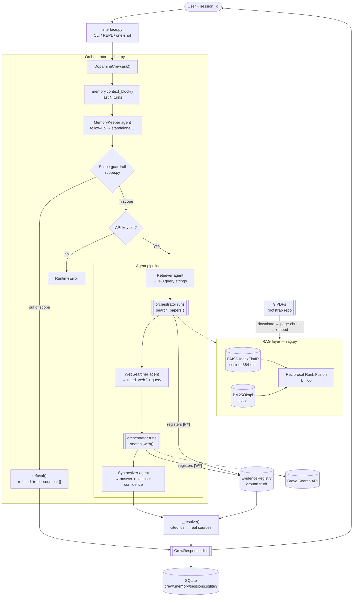

### 2.2 Two phases: build-time and query-time

The system has a **one-time build phase** and a **per-question query phase**.
They share only the persisted index directory.

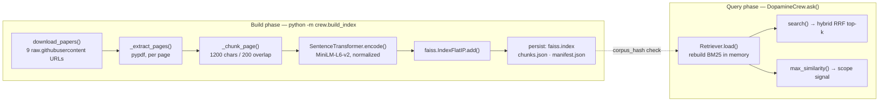

The `corpus_hash` in `manifest.json` is a SHA-256 over `(filename, filesize)` for
each paper, plus the embedding model name and the chunk parameters. If it
matches, `build_index()` short-circuits to `Retriever.load()` and no re-embedding
happens. That makes the build **idempotent** — safe to run on every deploy.

### 2.3 Actual index statistics

From `crew/.index/manifest.json` on a real build:

| Metric | Value |
|---|---|
| Papers | 9 |
| Chunks | **810** |
| Embedding dimension | **384** (MiniLM-L6-v2) |
| FAISS index type | `IndexFlatIP` (exact, brute-force inner product) |
| On-disk index size | ~2.2 MB (`crew/.index/`) |
| On-disk corpus size | ~7.1 MB (`crew/.papers/`) |

810 chunks × 384 dims × 4 bytes ≈ **1.24 MB** of float32 vectors. A flat exact
index over that is searched in microseconds. There is no scale argument for a
vector database here.

---

## 3. The agent graph — and the orchestrator question

### 3.1 The graph

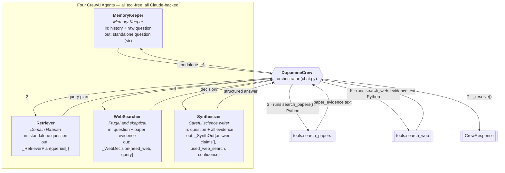

Each agent is a genuine `crewai.Agent` with a `role`, `goal`, `backstory`, and a
shared `crewai.LLM` bound to Claude. Each is executed as a **one-task, one-agent
`Crew`** via `DopamineCrew._run_agent()` (`crew/chat.py:107`), with
`process=Process.sequential`, `memory=False`, `verbose=False`.

### 3.2 Is there an orchestrator? Yes — and it is deliberate

**Yes.** `DopamineCrew` in `crew/chat.py` is a hand-written Python orchestrator.
It owns the control flow, executes the tools, and holds the correctness
invariants. The agents own only *judgment*.

This is a departure from the "classic" CrewAI shape, where you hand a `Crew` a
list of tool-equipped agents and let CrewAI's `Process.sequential` /
`Process.hierarchical` drive them. Two reasons drove the choice.

#### Reason 1 — a hard framework/model incompatibility

CrewAI's ReAct tool executor drives a tool-using agent by **prefilling the
assistant turn** (`Thought: …`) and asking the model to continue it.

Claude 4.6 and later — including `claude-opus-4-8`, this project's default
`AGENT_MODEL` — **reject assistant prefill**: the request must end with a user
message. A tool-equipped CrewAI agent on this model returns a **400**.

This was verified empirically during development, isolating each variable:

| Configuration | Result |
|---|---|
| CrewAI agent, no tools, plain text output | ✅ works |
| CrewAI agent, no tools, `output_pydantic=` structured output | ✅ works |
| CrewAI agent **with tools** (ReAct executor path) | ❌ 400 — assistant prefill rejected |

The options were: (a) downgrade the model to a pre-4.6 Claude, (b) patch or fork
CrewAI's executor, or (c) keep the agents tool-free and run the tools from
Python. Option (c) costs nothing in capability and gains something real, which
leads to reason 2.

> **Related project memory:** this failure mode is recorded as a cross-project
> gotcha — *tool-using CrewAI agents 400 on Claude 4.6+/4.8 (ReAct prefill); use
> tool-free agents + orchestrator-run tools; drop `temperature`; disable
> tracing.*

#### Reason 2 — grounding becomes an enforceable invariant

Because the orchestrator runs retrieval itself, **it** writes every hit into the
`EvidenceRegistry`. The Synthesizer can only cite ids (`P1`, `W2`, …); it never
writes a filename, page number, or URL. `_resolve()` then rebuilds `sources`
from the registry.

The consequence is structural: **a fabricated citation cannot appear in the
output.** If the model invents `[P9]` and the registry has only `P1..P6`,
`_resolve()` silently drops it (`registry.get(eid) is not None`, `chat.py:258`).
This is not prompt discipline — it is a Python-enforced invariant, and it is
directly unit-tested (`tests/test_resolve.py::test_unknown_evidence_ids_are_dropped`).

Had the agents called the tools themselves through the ReAct loop, tool results
would arrive as free text inside the model's context, and the correctness of the
`sources` list would depend on the model transcribing them faithfully.

#### Why not a hierarchical CrewAI process with an LLM manager?

`Process.hierarchical` gives CrewAI an LLM "manager" that decides the order of
work. That would have cost:

- one extra Claude call per turn purely for routing,
- non-determinism in a pipeline that has exactly one sensible order,
- loss of the **hard short-circuit** — the scope guardrail must run *before* any
  agent call, which is a control-flow decision, not a delegation decision.

The pipeline here is a fixed spine: `memory → scope → plan → retrieve → decide →
(web) → synthesize → resolve`. There is no branching an LLM manager could improve.
`allow_delegation=False` is set on all four agents for the same reason.

### 3.3 Division of responsibility

| Concern | Owner |
|---|---|
| Order of operations | Orchestrator |
| Refusing out-of-scope questions | Orchestrator (via `scope.check_scope`) |
| Executing RAG search | Orchestrator (`tools.search_papers`) |
| Executing web search | Orchestrator (`tools.search_web`) |
| Building the `sources` list | Orchestrator (`_resolve`) |
| Setting `used_web_search` | Orchestrator (`registry.any_web`) |
| Resolving coreference in follow-ups | MemoryKeeper agent |
| Phrasing effective retrieval queries | Retriever agent |
| Judging whether the web is needed | WebSearcher agent |
| Writing the answer and mapping claims | Synthesizer agent |
| Self-assessing confidence | Synthesizer agent |

**Rule of thumb applied throughout: agents decide, the orchestrator guarantees.**

---

## 4. The RAG layer

### 4.1 Corpus acquisition

`download_papers()` (`crew/rag.py:52`) fetches nine PDFs from
`raw.githubusercontent.com/rootstrap/ai-agents-challenge-papers/main`. Filenames
are pinned in `crew/config.py:37` — including one with a **double space** before
"the" (the Marsden paper), which `tests/test_config.py::test_double_space_filename_is_exact`
locks in, because a silent rename would break the download.

Filenames are `urllib.parse.quote`d for the URL. Downloads are skipped if the
file already exists unless `force=True`. The PDFs are **git-ignored** (they are
mostly copyrighted); `crew/.papers/SOURCES.md` is committed instead and lists
title, authors, venue, DOI, local filename, and license for each — two are
CC-BY 4.0, one is an NIH author manuscript, six are publisher-copyright and are
not redistributed.

### 4.2 Page-level chunking — the citation unit

This is the single most important design choice in the retrieval layer.

```python
for page_no, page_text in enumerate(_extract_pages(path), start=1):
    for piece in _chunk_page(page_text):
        chunks.append(Chunk(file=path.name, page=page_no, text=piece))
```

Text is extracted **one page at a time** with `pypdf`, and every chunk inherits
its `(file, page)` at construction. A page number in the final answer is
therefore a number that came out of the PDF extractor — not something a language
model produced. That is what makes "traceable to a paper file and page" a
property of the system rather than an aspiration.

Within a page, `_chunk_page()` normalizes whitespace and then emits overlapping
character windows of `chunk_chars=1200` with `chunk_overlap=200`. The overlap
means a concept spanning a window boundary still lands intact in at least one
chunk. Chunks never cross page boundaries, which keeps the citation unambiguous.

Pages that yield no text (scanned figures, extraction failures) are skipped —
`_extract_pages` catches per-page exceptions and appends `""`, and `_chunk_page`
returns `[]` for empty text.

### 4.3 Hybrid retrieval: dense + lexical + RRF

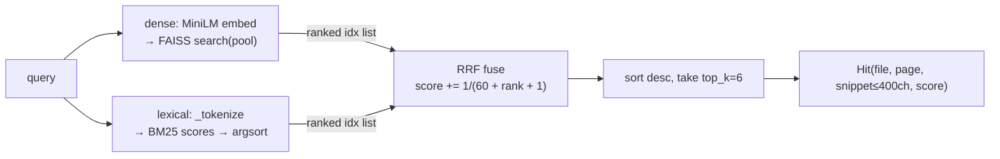

**Dense half** — `sentence-transformers/all-MiniLM-L6-v2`, 384 dimensions,
`normalize_embeddings=True` so inner product equals cosine, stored in
`faiss.IndexFlatIP`. Exact search, no approximation, no training step.

**Lexical half** — `rank_bm25.BM25Okapi` over the same chunks, tokenized with
`[A-Za-z0-9\-']+` and lowercased. The regex deliberately keeps hyphens and
apostrophes so `L-DOPA` and `Parkinson's` survive tokenization intact.

**Why the lexical half earns its place.** This corpus is dense with exact
tokens that dense embeddings blur: `D1`/`D2`/`D3`, `L-DOPA`, `substantia nigra`,
`nucleus accumbens`, `VTA`, receptor and gene symbols. A user asking "what does
D2 do?" wants the passages that literally say `D2`. MiniLM will happily return
semantically-adjacent passages about D1; BM25 will not. `tests/test_rag_integration.py::test_lexical_half_finds_exact_tokens`
guards this.

**Fusion** — Reciprocal Rank Fusion with `rrf_k=60`:

```
score(chunk) = Σ_retrievers  1 / (rrf_k + rank + 1)
```

RRF operates on **ranks, not scores**, which is exactly why it was chosen: cosine
similarity (0–1, tightly clustered) and BM25 (unbounded, corpus-dependent) are on
incomparable scales. Any score-level fusion would need calibration that drifts
with the corpus. RRF needs none. Both retrievers contribute a candidate pool of
`max(k*4, 20)` before fusion, so the fusion has room to promote a chunk that
ranked mid-list on both.

### 4.4 Retrieval as a scope signal

`Retriever.max_similarity(query)` (`rag.py:232`) embeds the query and returns the
single best cosine score against any chunk. This costs one embedding pass and one
`index.search(q, 1)` — no LLM, no network. It is the primary input to the
guardrail described next.

### 4.5 Deduplication at the tool boundary

`search_papers()` (`crew/tools.py:47`) runs the retriever once per planned query
and dedupes results by `(file, page)` across all of them. With 1–3 queries at
`top_k=6` each, the evidence block holds at most 18 passages and typically
fewer — bounded, and no page is ever shown twice.

---

## 5. The scope guardrail

Two layers, cheapest first.

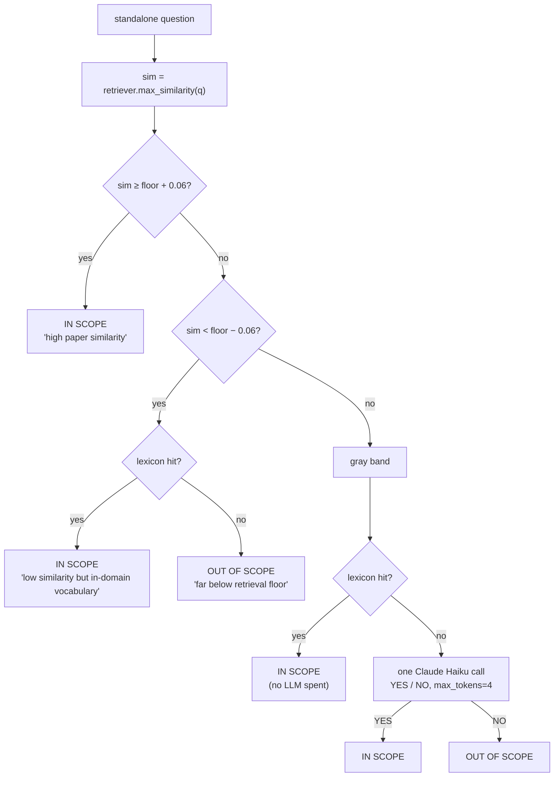

- **`floor` = `SCOPE_THRESHOLD`**, default `0.28`, configurable via env.
- **`GRAY_BAND` = `0.06`**, so the ambiguous zone is cosine `[0.22, 0.34]`.
- **`DOPAMINE_LEXICON`** is a 27-term set of unambiguous in-domain vocabulary
  (`dopamine`, `d1`…`d5`, `substantia nigra`, `l-dopa`, `mesolimbic`, …). It
  rescues terse questions the embedder underscores — a bare "What does D2 do?"
  is short enough that its embedding is diffuse, but it is obviously in scope.
- **`_llm_tiebreak`** uses `anthropic/claude-haiku-4-5` — deliberately *not* the
  main agent model — with `max_tokens=4` and a one-word answer contract.

Failure behavior is **fail-open**: `_llm_tiebreak` returns `True` on any
exception, and also `True` if no API key is configured. A transient network
error should not cause a wrongful refusal of a legitimate question. The
downstream cost of a false positive here is one wasted pipeline run; the cost of
a false negative is a user being told their valid question is off-topic.

An out-of-scope question short-circuits in `ask()` before the API-key check, so
**refusals work entirely offline** — which is what makes
`tests/test_crew_refusal.py` runnable in CI with no secrets.

---

## 6. Memory

### 6.1 Storage

SQLite at `crew/.memory/sessions.sqlite3`, one table:

```sql
CREATE TABLE IF NOT EXISTS turns (
    id         INTEGER PRIMARY KEY AUTOINCREMENT,
    session_id TEXT    NOT NULL,
    role       TEXT    NOT NULL,   -- 'user' | 'assistant'
    content    TEXT    NOT NULL,
    ts         REAL    NOT NULL
);
CREATE INDEX IF NOT EXISTS idx_session ON turns(session_id, id);
```

`MemoryStore` opens the connection with `check_same_thread=False` so a single
store can be shared across a threaded server, and commits on every write.

**Why SQLite rather than an in-process dict:** a session survives process
restarts and separate CLI invocations. You can `python -m crew.interface -s demo`
today, exit, come back tomorrow, and the follow-up still resolves. It also means
the full transcript is inspectable with any SQLite client — useful for audit and
debugging — at zero infrastructure cost.

### 6.2 The read path: bounded window

```python
def history(self, session_id, limit=None):
    limit = limit or self.max_turns          # default 8 messages
    rows = self._conn.execute(
        "SELECT role, content, ts FROM turns WHERE session_id = ? "
        "ORDER BY id DESC LIMIT ?", (session_id, limit)
    ).fetchall()
    return [Turn(...) for ... in reversed(rows)]
```

Two things matter here:

1. **`ORDER BY id DESC LIMIT n` then `reversed()`** — take the newest `n`, then
   restore chronological order. A naive `ORDER BY id ASC LIMIT n` would return
   the *oldest* turns, which is the opposite of what a follow-up needs.
2. **The window is a count of messages, not exchanges.** `max_turns=8` means four
   user/assistant pairs.

`context_block()` renders those turns as `User: …` / `Assistant: …` lines, each
truncated to 500 characters. Between the message cap and the per-message cap,
the injected history is bounded at roughly 4,000 characters no matter how long
the conversation runs. **Prompt cost per turn does not grow with session
length.** The full history stays in SQLite for audit; only the window is
injected.

### 6.3 How a follow-up actually resolves

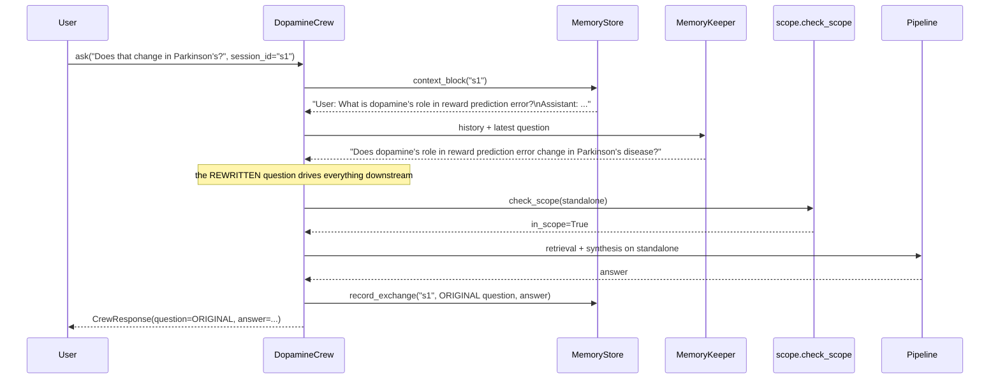

Two subtleties worth calling out:

- **The rewritten question feeds both scope and retrieval.** "Does that change in
  Parkinson's?" scores poorly against the corpus on its own and might be refused;
  the resolved form scores well and retrieves the right passages. Resolving
  coreference *before* the guardrail is what makes multi-turn conversation work
  at all.
- **The response echoes the user's original wording** (`resp["question"]`), and
  memory records the original too. The rewrite is an internal artifact — the user
  never sees their question reworded back at them.

### 6.4 Degradation

`_rewrite()` (`chat.py:140`) returns the question unchanged if there is no
history, if no API key is set, or if the agent call raises. A first turn costs
zero extra Claude calls; a transient failure degrades to "treat it as
standalone", which is correct for the large majority of questions.

### 6.5 Why not CrewAI's built-in memory?

Every `Crew` here is constructed with `memory=False`. CrewAI's memory subsystem
is designed as an intra-run scratchpad for agents within one kickoff, and it
pulls in its own embedding and vector-store stack. This project's requirement is
different: a **simple, inspectable, per-session transcript keyed by an id the
caller controls**, shared across four separate one-task kickoffs and across
process restarts. Those are different problems; a purpose-built 94-line store
fits better than configuring a general one.

---

## 7. The grounding guarantee

This is the mechanism the whole design serves, so it is worth stating precisely.

### 7.1 The registry

```python
class EvidenceRegistry:
    def add_paper(self, file, page, snippet) -> str:
        eid = f"P{len(self.papers) + 1}"
        self.papers[eid] = PaperSource(type="paper", file=file, page=page, snippet=snippet)
        return eid

    def add_web(self, url, title, snippet) -> str:
        eid = f"W{len(self.web) + 1}"
        self.web[eid] = WebSource(type="web", url=url, title=title, snippet=snippet)
        return eid
```

One registry per turn, populated *only* by the tool functions, from data that
came out of FAISS/BM25 or the Brave API. It is the single source of truth for
what evidence exists this turn.

### 7.2 What the Synthesizer sees and returns

It receives a text block of `[P1] file=… page=…\n<snippet>` entries and is
instructed to cite those ids inline and list them per claim. It returns
`_SynthOut`:

```python
class _SynthOut(BaseModel):
    answer: str
    claims: List[_ClaimOut]          # statement + evidence_ids
    used_web_search: bool
    confidence: Literal["high", "medium", "low"]
```

Note what is **not** in that schema: no `file`, no `page`, no `url`. The model has
no channel through which to emit a citation target.

### 7.3 `_resolve()` — where the guarantee is enforced

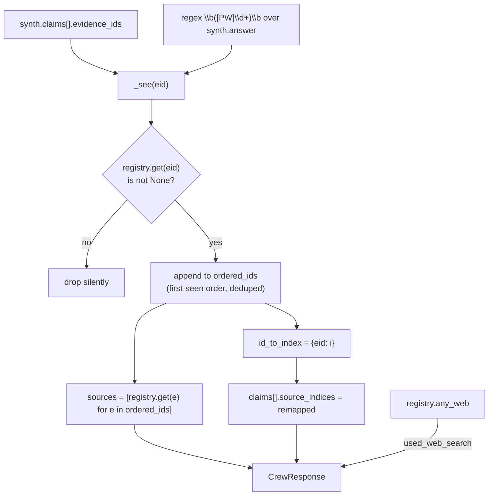

Four properties fall out of this, each with a test:

| Property | Test |
|---|---|
| Cited ids become real sources in first-seen order | `test_cited_ids_become_sources_in_first_seen_order` |
| Unknown ids (`P9`, `W7`) are dropped, claims remapped | `test_unknown_evidence_ids_are_dropped` |
| Repeated ids appear once in `sources` | `test_inline_answer_ids_are_deduped_into_sources` |
| `used_web_search` comes from the registry, not the model | `test_used_web_search_is_ground_truth_not_model_claim` |

That last one is worth dwelling on. The Synthesizer *self-reports*
`used_web_search`, and that value is **discarded**:

```python
used_web_search=registry.any_web,   # ground truth, not the model's word
```

A model claiming it consulted the web when no web result was ever registered
cannot make that claim stick. The same pattern — accept the model's judgment,
verify against system state — is applied wherever a factual field could drift.

### 7.4 Fallback

If `_coerce()` cannot extract a `_SynthOut` from the CrewAI result (structured
output failed, JSON malformed), `chat.py:243` substitutes a `low`-confidence
"I could not produce a grounded answer" response rather than raising. The
contract is preserved; the caller always gets a valid `CrewResponse`.

`_coerce()` itself tries three strategies in order: `result.pydantic`, then
`result.tasks_output[-1].pydantic`, then a brace-slice of `result.raw` fed
through `json.loads`. This is defensive against CrewAI version differences in
where the structured output lands.

---

## 8. Code walkthrough — file by file

```
crew/
├── __init__.py          23   public API surface
├── config.py            88   settings singleton, env loading, paper manifest
├── schema.py            79   TypedDict response contract + refusal builder
├── rag.py              266   download → chunk → embed → FAISS/BM25 → hybrid search
├── build_index.py       33   CLI entry point for the build phase
├── scope.py            107   two-layer out-of-scope guardrail
├── memory.py            94   SQLite per-session conversational memory
├── tools.py             99   EvidenceRegistry + search_papers + search_web
├── agents.py            94   four CrewAI Agent definitions + shared LLM
├── chat.py             286   DopamineCrew orchestrator (the spine)
└── interface.py        114   CLI / REPL / one-shot JSON
```

### `config.py` — settings and environment hygiene

A frozen `@dataclass` singleton, `settings`, holding credentials, model ids,
retrieval parameters, the scope threshold, and paths. `load_dotenv(PACKAGE_ROOT / ".env")`
is called with an explicit path so the app behaves identically regardless of the
working directory.

Three environment variables are set at import time, each fixing a concrete
observed failure:

```python
os.environ.setdefault("HF_HUB_DISABLE_IMPLICIT_TOKEN", "1")
os.environ.setdefault("CREWAI_TRACING_ENABLED", "false")
os.environ.setdefault("CREWAI_DISABLE_TELEMETRY", "true")
os.environ.setdefault("OTEL_SDK_DISABLED", "true")
```

- **`HF_HUB_DISABLE_IMPLICIT_TOKEN`** — only public HF models are downloaded
  (the embedder). If the machine has a stale or expired stored HF token, the hub
  sends it and the *public* download 401s. Forcing anonymous access fixes it.
  A user who genuinely needs a token can still set `HF_TOKEN` explicitly.
- **`CREWAI_TRACING_ENABLED=false`** — CrewAI ships an interactive
  "view execution traces?" prompt that blocks non-interactive and CI runs.
- **Telemetry / OTEL off** — background noise and network calls in an otherwise
  offline-capable test suite.

`litellm_model` is a property returning `f"anthropic/{agent_model}"` — CrewAI
talks to Claude through litellm, which wants the provider prefix, while prompts
and logs want the bare id.

### `schema.py` — the contract

Pure typing plus one constructor. `PaperSource` and `WebSource` are `TypedDict`s
discriminated on a `Literal` `type` field; `Source` is their union; `Claim` maps
a statement to `source_indices`; `CrewResponse` is the nine-key envelope. Because
they are `TypedDict`s, instances are **plain dicts at runtime** — `json.dumps`
works with no encoder, and the caller does not need Pydantic to consume the
output.

`refusal(session_id, question)` is the single constructor for the out-of-scope
response, which guarantees every refusal is byte-identical in shape.

### `rag.py` — the retrieval engine

Covered in [§4](#4-the-rag-layer). Implementation notes worth flagging:

- Heavy imports (`faiss`, `sentence_transformers`) are **function-local**, so
  importing `crew` is fast and doesn't pull in torch until retrieval is needed.
- `Retriever._embedder` is lazily constructed on first embed — the model loads
  once per process, not per query.
- `chunks.json` is written with `encoding="utf-8"` and `ensure_ascii=False`
  explicitly. PDF text is full of ligatures (`fi`, `fl`), Greek letters, and
  typographic dashes that the Windows default `cp1252` cannot encode. Without the
  explicit encoding, the build crashes on Windows.
- BM25 is **rebuilt in memory on every `Retriever.load()`** from `chunks.json`.
  For 810 chunks this is milliseconds; it avoids persisting a second index format.

### `scope.py` — the guardrail

Covered in [§5](#5-the-scope-guardrail). Note that it depends on the retriever
only through `max_similarity`, keeping it decoupled from indexing — which is
exactly what lets `tests/test_scope.py` drive it with a 4-line `FakeRetriever`.

### `memory.py` — the session store

Covered in [§6](#6-memory). `db_path` is injectable so tests can point at a
`tmp_path` database.

### `tools.py` — evidence acquisition

`search_papers(retriever, registry, queries, k=None)` runs the hybrid search per
query, dedupes by `(file, page)`, registers each hit, and returns a formatted
text block for the Synthesizer's context.

`search_web(registry, query, max_results=5)` calls the Brave Search REST API
directly (`GET /res/v1/web/search` with an `X-Subscription-Token` header,
20-second timeout) and registers `title`/`url`/`description` per result.

**Graceful degradation is explicit.** Rather than raising, it returns a status
string:

```python
_NO_WEB_PREFIXES = ("WEB_SEARCH_UNAVAILABLE", "WEB_SEARCH_ERROR", "No web results")
```

The orchestrator checks that prefix tuple (`chat.py:213`) and simply omits the
web block from the evidence. **No Brave key, a quota error, or a network failure
degrades to a paper-only answer** — never to a crash. Writing directly against
the REST API rather than using a CrewAI search tool was chosen for exactly this:
control over the citation format and over the failure mode.

### `agents.py` — the crew

`build_llm()` returns a shared `crewai.LLM`:

```python
return LLM(model=settings.litellm_model, api_key=settings.anthropic_api_key)
```

**No `temperature`.** Sampling parameters (`temperature`, `top_p`, `top_k`) were
removed on Claude Opus 4.7/4.8 and return a 400 if sent. Passing one here would
break every call.

`build_agents(llm)` returns the four agents. Each has `verbose=False` and
`allow_delegation=False`. The prompts are written as role/goal/backstory in
CrewAI's idiom, and they encode the behavioral contract — e.g. the Synthesizer's
backstory: *"You would rather say 'the provided sources don't cover this' than
fabricate a citation."*

### `chat.py` — the orchestrator

The spine. Public surface is one method:

```python
def ask(self, question: str, session_id: str = "default") -> CrewResponse
```

Internals:

| Member | Role |
|---|---|
| `_rewrite` | MemoryKeeper step; falls through to the raw question on any failure |
| `_run_pipeline` | Retriever → RAG → WebSearcher → Brave → Synthesizer |
| `_run_agent` (static) | Wraps a single agent as a one-task `Crew` and kicks it off |
| `_coerce` (static) | Extracts a Pydantic instance from a CrewAI result, three strategies |
| `_resolve` (static) | Rebuilds `sources`/`claims` from the registry |

Two constructor details matter:

- `Retriever.load()` is called eagerly (it is LLM-free, so it works without an
  API key — which is what lets integration tests construct a `DopamineCrew`
  offline), while `self._agents = None` defers agent construction to
  `_ensure_agents()`, since that *does* need the key.
- Both `retriever` and `memory` are injectable, which is how the test suite
  supplies a throwaway SQLite file.

The API-key check is placed **after** the scope check (`chat.py:87`), which is
what makes the refusal path fully offline.

### `interface.py` — the front end

Three modes:

```powershell
python -m crew.interface                                   # REPL
python -m crew.interface -q "..." --json                   # one-shot JSON
python -m crew.interface -s my-session                     # resume a session
```

REPL commands: `/new` (fresh random session id), `/session <id>`, `/json`
(toggle raw dict), `/quit`. Human output prints a `[HIGH confidence · web used]`
banner, the answer, an indexed source list, and a claim→source mapping.

`sys.stdout.reconfigure(encoding="utf-8")` at import guards against the Windows
console's `cp1252` default, which cannot print the α/β glyphs and ligatures that
appear routinely in neuroscience text.

---

## 9. Data model / response contract

Every call to `ask()` returns exactly this shape:

```jsonc
{
  "session_id": "demo",
  "question": "What is dopamine's role in reward learning?",   // user's ORIGINAL wording
  "answer": "Dopamine neurons encode a reward prediction error ... [P2][P5]",
  "sources": [
    { "type": "paper", "file": "da_reward_learning_wise.pdf", "page": 4, "snippet": "..." },
    { "type": "web",   "url": "https://...", "title": "...", "snippet": "..." }
  ],
  "claims": [
    { "statement": "Dopamine neurons signal reward prediction error.", "source_indices": [0] }
  ],
  "in_scope": true,
  "refused": false,
  "used_web_search": true,        // ground truth from the registry
  "confidence": "high"            // "high" | "medium" | "low"
}
```

Invariants:

- The shape is **identical for refusals** — `answer` is `REFUSAL_TEXT`,
  `refused: true`, `in_scope: false`, `sources: []`, `claims: []`,
  `used_web_search: false`, `confidence: "high"` (the system is confident the
  question is out of scope).
- `source_indices` are indices into *this response's* `sources` array.
- Every entry in `sources` was produced by a tool this turn.
- `json.loads(json.dumps(resp)) == resp` — asserted in two separate tests.

---

## 10. Testing strategy

### 10.1 Current status

```
31 passed, 1 skipped in 45.58s
```

The skip is `test_in_scope_passes_scope_then_gates_on_key`, which correctly skips
when an API key *is* present (it would otherwise perform a live synthesis call).

### 10.2 The principle: test what is deterministic

The suite deliberately covers the paths whose behavior is guaranteed by code, not
by a language model. It does **not** assert on the content of generated answers —
that would be flaky, expensive, and would test Anthropic rather than this
project. What it does assert is every invariant the orchestrator promises.

### 10.3 Coverage map

| File | Tests | Covers |
|---|---|---|
| `test_schema.py` | 4 | Refusal contract — all nine keys present, flags correct, empty sources/claims, identifiers preserved, JSON round-trip |
| `test_scope.py` | 5 | Guardrail decision boundary: high-similarity, far-below-floor refusal, lexicon rescue, gray-band LLM tie-break (both directions), and that a lexicon hit **skips** the LLM call |
| `test_resolve.py` | 5 | The grounding guarantee — ordering, unknown-id dropping, dedup, claim remapping, `used_web_search` ground truth |
| `test_memory.py` | 6 | Ordering, `context_block` rendering, session isolation, bounded window, `clear`, empty-history case |
| `test_config.py` | 5 | 9 unique `.pdf` filenames, the exact double-space filename, litellm prefix, threshold type/range, HF token flag set at import |
| `test_rag_integration.py` | 3 | *(needs index)* Page-level citations point at real papers with `page ≥ 1`; in-domain similarity > threshold > off-topic; BM25 surfaces exact tokens |
| `test_crew_refusal.py` | 3 | *(needs index)* End-to-end refusal via `ask()`, refusal recorded in memory, in-scope question passes scope then hits the key gate |

### 10.4 Techniques worth noting

**Deterministic guardrail testing via a fake retriever.** `test_scope.py` defines
a 4-line `FakeRetriever` returning a fixed similarity, so every branch of
`check_scope` is exercised at an exact distance from the threshold — no index, no
embeddings, no LLM, no flakiness.

**Negative-assertion monkeypatching.** To prove the lexicon short-circuit avoids
paying for an LLM call:

```python
monkeypatch.setattr(
    "crew.scope._llm_tiebreak",
    lambda q: (_ for _ in ()).throw(AssertionError("LLM should not be called")),
)
```

The test fails loudly if the code path ever reaches the model. This asserts a
*cost* property, not just a correctness one.

**Clean skips over silent passes.** The `retriever` fixture in `conftest.py`
calls `pytest.skip(...)` with an actionable message if the index is missing, so
integration tests are informative on a fresh clone rather than either failing or
vacuously passing.

**No API key required.** The entire suite runs offline. Unit tests need nothing;
integration tests need only a built index.

### 10.5 What is not covered

- Answer quality / factual accuracy of generated text (would require an eval set
  and an LLM judge — see [§14](#14-production-deployment)).
- The live Brave path (`search_web` with a real key) — only its degradation
  behavior is exercised indirectly.
- Concurrency on `MemoryStore` under real parallel load.

---

## 11. Decision log (with rejected alternatives)

| # | Decision | Chosen | Rejected | Rationale |
|---|---|---|---|---|
| 1 | Framework | CrewAI | LangGraph, raw SDK | Required by the challenge; agents map cleanly onto the four judgment roles |
| 2 | Agent/tool wiring | Tool-free agents, orchestrator runs tools | CrewAI ReAct tool executor | ReAct prefills the assistant turn → **400 on Claude 4.8**; also enables the grounding guarantee |
| 3 | Process | Fixed Python spine | `Process.hierarchical` | One sensible order exists; a manager LLM adds cost and non-determinism, and cannot express the pre-spend scope short-circuit |
| 4 | Chunk unit | Per page, then 1200/200 windows | Whole-document or fixed-N-token chunks | Page number *is* the citation; per-page extraction makes it real rather than inferred |
| 5 | Retrieval | Hybrid dense + BM25 via RRF | Dense only | Exact tokens (`D2`, `L-DOPA`, gene symbols) are where dense retrieval is weakest and scientific questions are most precise |
| 6 | Fusion | Reciprocal Rank Fusion | Weighted score blending | Cosine and BM25 are on incomparable scales; RRF is rank-based and needs no calibration |
| 7 | Embeddings | Local MiniLM-L6-v2 | OpenAI/Voyage embedding API | Zero per-query cost, no extra key, CPU-only, adequate at this corpus size |
| 8 | Vector store | Flat FAISS + JSON chunk cache | pgvector / Qdrant / Chroma | 810 chunks → exact search is instant; a hosted DB adds latency, cost, and ops for no recall benefit |
| 9 | Reranking | None | Cross-encoder reranker | Deliberately omitted: heavier install, added latency, marginal gain at nine papers. Ranked in [§14.3](#143-scale-up-order) |
| 10 | Web backend | Brave REST API, called directly | CrewAI `SerperDevTool` / built-in search | Real titles + URLs for citations, usable free tier, and full control over the failure mode |
| 11 | Guardrail | Retrieval floor, then Haiku tie-break | Always-LLM classification | Most questions cost zero LLM tokens to classify; only the narrow gray band pays, and only for a cheap model |
| 12 | Guardrail failure mode | Fail-open | Fail-closed | A transient error must not wrongly refuse a valid question |
| 13 | Memory | Own SQLite store | CrewAI built-in memory | Needs cross-process, per-`session_id`, inspectable transcript; CrewAI's is an intra-run scratchpad with its own vector stack |
| 14 | Memory window | 8 messages, 500 chars each | Full history | Keeps prompt cost flat regardless of session length; full history stays in SQLite for audit |
| 15 | Output type | `TypedDict` | Pydantic model | Plain dicts at runtime → `json.dumps` works, callers need no Pydantic dependency |
| 16 | `used_web_search` | From registry | From model self-report | Cannot drift from reality |
| 17 | Sampling params | None sent | `temperature=0` | Removed on Opus 4.7/4.8; sending one returns 400 |
| 18 | PDFs in git | Not committed; `SOURCES.md` instead | Commit the corpus | Six of nine are publisher-copyright; the manifest gives DOIs and licenses so anyone can reproduce the corpus |

---

## 12. Requirements and setup

### 12.1 Runtime requirements

| Requirement | Detail |
|---|---|
| **Python** | 3.11+ |
| **OS** | Any; Windows-specific hazards (cp1252, wheel-only installs) already handled |
| **RAM** | ~1 GB for the embedding model + index during a build; less at query time |
| **Disk** | ~10 MB project artifacts + ~90 MB one-time HF model cache |
| **Network (build)** | GitHub raw (PDFs) + Hugging Face (embedder), once |
| **Network (query)** | api.anthropic.com; api.search.brave.com (optional) |
| **GPU** | Not required — MiniLM runs on CPU |

### 12.2 Dependencies

```
# Orchestration
crewai>=0.86,<1.0
crewai-tools>=0.17

# LLM access (CrewAI → litellm → Anthropic)
litellm>=1.55

# RAG layer
sentence-transformers>=3.0      # local embeddings, no API key
faiss-cpu>=1.8                  # dense vector index
rank-bm25>=0.2.2                # lexical retrieval
pypdf>=4.2                      # page-level PDF extraction

# Infra
python-dotenv>=1.0
requests>=2.31
numpy>=1.26
pydantic>=2.7
```

Dev: `pytest>=8.0`.

### 12.3 Credentials

| Variable | Required | Purpose |
|---|---|---|
| `ANTHROPIC_API_KEY` | **Yes** (for synthesis) | Powers all four agents and the Haiku tie-breaker |
| `BRAVE_SEARCH_API_KEY` | No | Enables the WebSearcher path; absent → clean "web unavailable" |
| `AGENT_MODEL` | No | Default `claude-opus-4-8` |
| `EMBED_MODEL` | No | Default `sentence-transformers/all-MiniLM-L6-v2` |
| `SCOPE_THRESHOLD` | No | Default `0.28` |

Retrieval and the scope guardrail work with **no keys at all** — only synthesis
requires Anthropic.

### 12.4 Install

```powershell
# 1. Dependencies — wheels only, to avoid source builds on Windows
.venv\Scripts\python.exe -m pip install --only-binary=:all: -r crew\requirements.txt

# 2. Secrets
copy crew\.env.example crew\.env
#    then set ANTHROPIC_API_KEY (and BRAVE_SEARCH_API_KEY)

# 3. Build the index (downloads 9 PDFs; first run also pulls the embedder)
.venv\Scripts\python.exe -m crew.build_index
```

> `--only-binary=:all:` is not cosmetic. Several transitive dependencies ship
> Rust-backed extensions; without a Rust toolchain on Windows, a source build
> fails. Forcing wheels avoids the whole class of problem.

First run downloads the sentence-transformers model (a few hundred MB) — expect a
one-to-two-minute pause. It is not hung.

### 12.5 Run

```powershell
.venv\Scripts\python.exe -m crew.interface                                  # REPL
.venv\Scripts\python.exe -m crew.interface -q "D1 vs D2 receptors?" --json  # one-shot
.venv\Scripts\python.exe -m pytest                                          # tests
```

```python
from crew import DopamineCrew
crew = DopamineCrew()
resp = crew.ask("What is dopamine's role in reward learning?", session_id="demo")
```

---

## 13. Costs

### 13.1 Where money is spent — and where it isn't

| Layer | Cost |
|---|---|
| PDF download | Free, once |
| Embedding model download | Free, once (~90 MB) |
| Index build (embedding 810 chunks) | **$0** — local CPU |
| Per-query embedding | **$0** — local CPU |
| FAISS + BM25 search | **$0** |
| Scope check (common cases) | **$0** — vector lookup only |
| Scope check (gray band) | 1 × Haiku call, ≤4 output tokens |
| MemoryKeeper (first turn) | **$0** — skipped when history is empty |
| MemoryKeeper (follow-ups) | 1 × Opus call |
| Retriever / WebSearcher / Synthesizer | 3 × Opus calls |
| Brave Search | Free tier: 2,000 queries/month |

**Retrieval is free.** That is the direct consequence of decision #7 — every
per-query embedding is computed on the local CPU, so query volume does not scale
retrieval cost at all.

### 13.2 Model pricing (Anthropic first-party, per million tokens)

| Model | Input | Output |
|---|---|---|
| `claude-opus-4-8` (default `AGENT_MODEL`) | **$5.00** | **$25.00** |
| `claude-haiku-4-5` (`GUARD_MODEL`) | **$1.00** | **$5.00** |

### 13.3 Per-question estimate

Token counts below are estimates for a typical in-scope question with 6–12
retrieved passages (each snippet capped at 400 characters ≈ 100 tokens) and an
8-message memory window (capped at 500 characters each).

| Call | Model | ~Input tok | ~Output tok |
|---|---:|---:|---:|
| MemoryKeeper (follow-ups only) | Opus 4.8 | 900 | 40 |
| Retriever (query planning) | Opus 4.8 | 400 | 60 |
| WebSearcher (decision, sees paper evidence) | Opus 4.8 | 1,800 | 40 |
| Synthesizer (sees all evidence) | Opus 4.8 | 2,400 | 700 |
| **Total (follow-up turn)** | | **≈ 5,500** | **≈ 840** |

```
input:   5,500 / 1e6 × $5.00  = $0.0275
output:    840 / 1e6 × $25.00 = $0.0210
                                --------
                        total  ≈ $0.049 per question
```

| Scenario | Estimated cost |
|---|---|
| **Out-of-scope question** (clear) | **$0.00** — no LLM call at all |
| **Out-of-scope question** (gray band) | ~$0.0002 — one Haiku call, 4 output tokens |
| **First in-scope question** (no memory rewrite) | ~$0.044 |
| **In-scope follow-up** | ~$0.049 |
| **100-question session** | ~$5 |
| **10,000 questions/month** | ~$490/month + $0 retrieval |

CrewAI adds framework scaffolding to each prompt (role/goal/backstory,
task description, expected-output instructions), so treat these as
order-of-magnitude figures and measure with `count_tokens` before budgeting
seriously.

### 13.4 Cost controls already in the design

1. **Free retrieval** — no embedding API, ever.
2. **Zero-cost refusals** — the scope guardrail rejects off-domain questions
   before a single token is spent; only the gray band pays, and only for Haiku.
3. **Conditional web search** — Brave is called only when the WebSearcher judges
   the papers insufficient, keeping the free tier viable.
4. **Bounded prompts** — memory capped at 8 messages × 500 chars; snippets capped
   at 400 chars; evidence deduped by `(file, page)`. **Cost per turn does not
   grow with session length or corpus size.**
5. **Conditional MemoryKeeper** — skipped entirely on the first turn of a session.
6. **Model tiering already in place** — the guardrail deliberately uses Haiku, not
   Opus.

### 13.5 Further cost levers

| Lever | Effect |
|---|---|
| `AGENT_MODEL=claude-sonnet-5` | ~40% cheaper input, ~40% cheaper output; one env var |
| Split models per agent | Retriever/WebSearcher are trivial classification tasks — Haiku would do. Opus only for the Synthesizer. Cuts the two mid-pipeline calls ~5× |
| Anthropic prompt caching | The agent system prompts (role/goal/backstory) are byte-stable across every call — a natural cache prefix. Cache reads are ~0.1× input price |
| Merge Retriever into the query | Use the standalone question directly as the retrieval query and drop one call entirely; costs some retrieval precision |
| Response cache | Identical `(question, session)` pairs skip the pipeline |
| Batch API | 50% discount for offline/bulk evaluation runs |

---

## 14. Production deployment

### 14.1 Target architecture

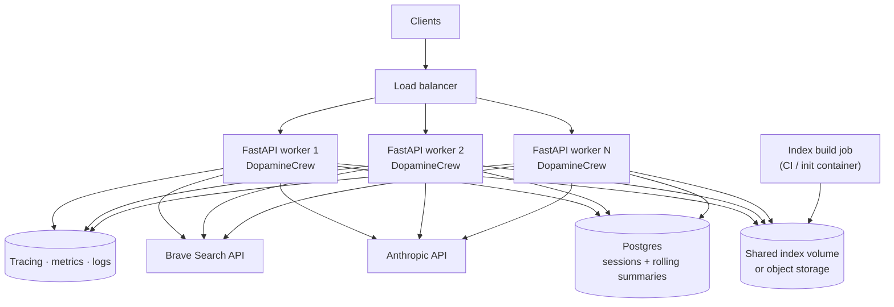

`DopamineCrew.ask` is already stateless apart from the shared memory store, so
the horizontal scaling story is straightforward: wrap it in a FastAPI endpoint
and move memory to a shared database.

### 14.2 Checklist before going live

**Serving**
- [ ] Wrap `ask()` in FastAPI: `POST /ask {question, session_id}` → `CrewResponse`.
- [ ] Build the index in CI or an init container; ship it as a layer or mount it
      from object storage. Do **not** build on first request — the model download
      alone is a multi-minute cold start.
- [ ] Instantiate `DopamineCrew` once at startup, not per request (the retriever
      and embedder load once).
- [ ] Add request timeouts and a bounded concurrency limit; Opus calls are slow
      and the pipeline makes 3–4 of them serially.

**Memory**
- [ ] Move `MemoryStore` from SQLite to Postgres. The schema is one table and one
      index — the migration is mechanical. SQLite's single-writer model will not
      survive multi-worker concurrency.
- [ ] Add a **rolling summary** of turns older than the window, so very long
      sessions keep coreference ability without unbounded history.
- [ ] Define a retention policy — transcripts are user data.

**Retrieval**
- [ ] Keep flat FAISS until the corpus exceeds ~10⁵ chunks (≈ 100× the current
      size). Past that, swap in pgvector / Qdrant / LanceDB. The `Retriever`
      interface (`search`, `max_similarity`) is the seam — nothing above it
      changes.
- [ ] Add a **cross-encoder reranker** over the fused top-k when precision on hard
      queries matters more than the extra latency.
- [ ] Version the index (`corpus_hash` already exists) and pin responses to an
      index version for reproducibility.

**Cost and performance**
- [ ] Enable Anthropic prompt caching on the stable agent system prefixes.
- [ ] Route the Retriever and WebSearcher to a cheaper model; keep Opus for
      synthesis only.
- [ ] Cache identical `(question, session_id)` synthesis results.
- [ ] Set a per-tenant budget/rate limit.

**Reliability**
- [ ] Add retry with exponential backoff around Anthropic calls (429 / 5xx);
      `litellm` retries some cases but the policy should be explicit.
- [ ] The Brave degradation path already exists — add a metric for how often it
      fires so a dead key is noticed.
- [ ] Health check that asserts `Retriever.load()` succeeds and the manifest hash
      matches.

**Observability**
- [ ] Per-request tracing across the four agent calls (note `OTEL_SDK_DISABLED`
      is set in `config.py` for CI hygiene — re-enable deliberately in prod).
- [ ] Log per-turn: `scope.similarity`, `scope.reason`, number of `[P#]`/`[W#]`
      registered, number of cited ids **dropped** by `_resolve` (a rising drop
      rate is an early warning of model drift), `used_web_search`, `confidence`,
      token usage per call.
- [ ] Alert on refusal rate — a spike may mean the corpus or threshold drifted.

**Safety and correctness**
- [ ] Add a **hard output validator**: every in-scope claim must carry
      `len(source_indices) >= 1`, else downgrade `confidence` or refuse. The
      schema docstring already states this as a contract; enforce it in code.
- [ ] Consider rejecting answers where `sources == []` but `refused == False`.
- [ ] Add PII/prompt-injection screening on input if the endpoint is public.
- [ ] Build an eval set (question → expected paper/page) and run recall@k in CI
      so retrieval regressions are caught.

**Security**
- [ ] Keys via a secrets manager, not `.env` (already git-ignored, but not a
      production mechanism).
- [ ] Rate-limit per client; a single unbounded caller is a direct cost exposure.
- [ ] Sanitize `session_id` at the API boundary — it is a database key.

**Legal**
- [ ] Six of the nine papers are publisher-copyright. `SOURCES.md` documents
      this. Confirm license terms permit a hosted retrieval index and snippet
      display before exposing the service publicly.

### 14.3 Scale-up order

§14.2 is a checklist, not a plan — it says *what* to do, not *when*. This
section ranks the same levers. The ordering principle is: **make the system
measurable, then correct, then cheap, then precise, then concurrent.** Precision
work placed before measurement is unfalsifiable, and cost work placed before
correctness optimizes a pipeline you may still have to change.

| # | Lever | Trigger | Effort | Why here |
|---|---|---|---|---|
| **0** | Eval set (question → expected file/page) + recall@k in CI | Before any retrieval change | M | Nothing below #3 can be *justified* without it. Today no change to `top_k`, `rrf_k`, the pool width, or the embedder can be shown to help or hurt |
| **1** | Enforce `len(source_indices) >= 1` on in-scope claims | Immediately | S | Closes a live gap: `_resolve` currently emits unsupported claims (`chat.py:278`). The contract is already written down — this makes it real |
| **2** | Anthropic prompt caching on agent system prefixes | Any sustained traffic | S | Role/goal/backstory are byte-stable across every call — a natural cache prefix, no behavior change |
| **3** | Per-agent model tiering (Haiku for Retriever/WebSearcher, Opus for Synthesizer only) | Any sustained traffic | S | Two of the three pipeline calls are classification. Cuts them ~5× and shortens latency at the same time |
| **4** | Cross-encoder reranker over a widened fused pool | Precision complaints, or recall@k plateaus | M | *The classic "first lever" — but it is #4, not #1, because #0 is what tells you whether it helped.* Insert between `fused = sorted(...)` and `Hit` construction (`rag.py:255`); widen the `[:k]` slice to feed it candidates |
| **5** | `MemoryStore` → Postgres | The moment you run more than one worker | M | Hard blocker, not an optimization: SQLite is single-writer. One table, one index — the migration is mechanical |
| **6** | Rolling summary of turns older than the window | Sessions routinely exceeding 8 messages | M | Restores coreference on long sessions without unbounded prompt growth |
| **7** | Corpus expansion beyond nine papers | Product decision | S–L | Config change + rebuild. **Re-tune `scope_threshold` when you do** — `0.28` is fitted to this corpus and nothing tests that it still holds |
| **8** | Flat FAISS → pgvector / Qdrant / LanceDB | ~10⁵ chunks (≈ 100× today) | M | `Retriever.search` / `max_similarity` is the seam; nothing above it changes. Premature before that — 810 chunks search exactly in microseconds |

**Effort:** S ≈ hours · M ≈ days · L ≈ weeks.

**On latency.** The pipeline is 3–4 serial Opus calls, and #3 is the only lever
here that shortens it. Note that Retriever and WebSearcher **cannot** be
overlapped as written: WebSearcher's task receives `paper_evidence` in its
prompt (`chat.py:190`) precisely so it can judge whether the papers already
suffice. Parallelizing them means deciding about the web *blind*, which trades
answer quality for a second or two. Treat it as a redesign, not a lever.

**What is deliberately absent.** Query rewriting/expansion, HyDE, multi-hop
retrieval, and an agentic retrieve-critique-retry loop are all plausible and all
unranked here — each adds at least one model call per turn to a pipeline whose
retrieval is currently free. Revisit only if #0 shows retrieval, not synthesis,
is the failure mode.

---

## 15. Known limitations

| Limitation | Impact | Mitigation path |
|---|---|---|
| Knowledge is frozen to nine papers | Cannot answer beyond the corpus except via web search | The web path exists; expanding the corpus is a config change + rebuild |
| No reranker | Precision on hard queries is fusion-limited | [§14.3](#143-scale-up-order) lever #4 — gated on the eval set (#0) |
| SQLite memory | Single-writer; not safe for multi-worker concurrency | Postgres migration (one table) |
| Fixed 8-message window | Very long sessions lose early context | Rolling summary of older turns |
| Text-only PDF extraction | Figures, tables, and scanned pages are invisible | OCR / layout-aware extraction |
| Serial pipeline | 3–4 Opus calls in sequence → multi-second latency | Retriever and WebSearcher could overlap; smaller models for both |
| No answer-quality tests | Regressions in generation quality are invisible to CI | Eval set + LLM judge |
| Scope threshold is a hand-tuned constant | `0.28` was chosen empirically for this corpus | Re-tune on corpus change; it is already env-configurable |
| `confidence` is model self-report | Unlike `used_web_search`, it is not verified | Could be derived from retrieval scores and claim coverage |

---
---

# Part II — the scientist knowledge graph

## 16. What the graph is

Part I treats the nine PDFs as **text to retrieve from**. Part II treats the
same nine PDFs as **a record of who did the work**: their authors, those
authors' institutions and research interests, and — through every reference
list — the several thousand researchers they cite and co-cite.

The product is a typed, evidenced knowledge graph plus a recommender that
answers *who should connect with whom*, a natural-language interface over the
graph, and a self-contained HTML map.

### 16.1 The graph as actually built

From `crew/.graph/graph.json` on a real build of the nine papers:

| Node kind | Count | Where it comes from |
|---|---:|---|
| **Scientist** | **3,640** | Front matter (36 corpus authors) + every reference list |
| **Institution** | **45** | Author affiliations, plus ROR-backed ones from OpenAlex |
| **Topic** | **17** | An LLM-derived taxonomy over the corpus, cached |
| **Paper** | **1,366** | The nine PDFs (`in_corpus: true`) + every work they cite |

| Relation | Count | Meaning |
|---|---:|---|
| `CO_AUTHORED` | 24,126 | scientist ↔ scientist — symmetric, stored both ways |
| `WORKS_ON` | 9,756 | scientist → topic, weighted by strength of interest |
| `AUTHORED` | 5,576 | scientist → paper |
| `COVERS` | 3,205 | paper → topic |
| `CITES` | 1,398 | corpus paper → cited work |
| `AFFILIATED_WITH` | 62 | scientist → institution |
| **Total** | **44,123** | |

On disk: `graph.json` ≈ 18 MB, `graph.html` ≈ 2.5 MB, `taxonomy.json` ≈ 10 KB.

Note the shape of that table. `AFFILIATED_WITH` is two orders of magnitude
rarer than `CO_AUTHORED`, and that is not a bug — it is the defining constraint
of the whole subsystem, explained in [§18.4](#184-the-affiliation-asymmetry).

### 16.2 The provenance model

Every node and every edge carries at least one `Evidence` entry:

```python
class Evidence(TypedDict):
    file: str      # "nihms-987662.pdf", or "openalex" / "graph" for derived facts
    page: int      # 1-indexed page within that PDF; 0 when not from a PDF
    snippet: str   # supporting text, capped at 300 chars
```

Nothing enters the graph without one. That is what lets a recommendation be
*defended* — "these two share reward prediction error, asserted on p.3 of Berke
and p.2 of Schultz" — rather than merely asserted, and it is the same
`file + page` guarantee the retrieval layer provides in
[§4.2](#42-page-level-chunking--the-citation-unit).

The `file` field doubles as a source discriminator. `"openalex"` marks a fact
fetched from the web ([§21](#21-openalex-enrichment)); `"graph"` marks one
derived from graph state at query time ([§22](#22-graphrag--answering-in-natural-language)).
A consumer can tell a corpus observation from an external one without a second
field, and `page: 0` reads as "not a page" everywhere a page is displayed.

### 16.3 Division of responsibility

The same rule as Part I, applied to a different problem:

| Concern | Owner | Why |
|---|---|---|
| Parsing messy bibliographies | LLM | Nine citation styles; a regex per style is brittle work |
| Deciding two names are one person | `canon.py` | Must be stable across rebuilds and unit-testable |
| Choosing the topic vocabulary | LLM (once, then cached) | A judgment about what the corpus is about |
| Assigning topics to papers | `topics.py` | Deterministic and free |
| Scoring recommendations | `recommend.py` | Numbers must not drift with model mood |
| Deciding what to look up | Navigator agent | Intent classification is a judgment |
| Narrating an answer | Analyst agent | Prose is what models are for |
| Deciding which citations are real | `chat.py::_resolve` | An invented `[G9]` is dropped, not printed |

**Agents decide, the orchestrator guarantees** — [§3.2](#32-is-there-an-orchestrator-yes--and-it-is-deliberate)
holds here for the same two reasons, including the same hard 400 on tool-using
CrewAI agents against Claude 4.6+.

---

## 17. The build pipeline

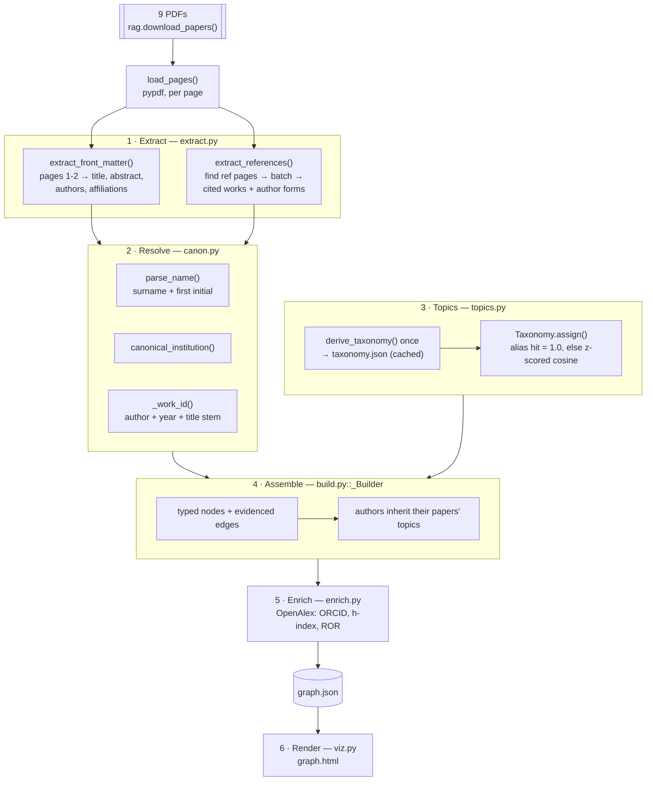

### 17.1 Idempotency, and what is deliberately outside it

Like `crew.build_index`, the build short-circuits when nothing has changed.
`_corpus_hash()` (`crew/graph/build.py:65`) is a SHA-256 over:

- each PDF's **name and size**,
- `graph_extract_model` and `embed_model`,
- `refs=<bool>` and `graph_min_mentions`.

If the persisted hash matches, the build loads `graph.json` and returns. Safe
to run on every deploy.

**The taxonomy is cached separately and reused unless `--force`.** Topic ids
*are* node ids, so re-deriving on every build would silently re-partition
everyone's research interests — a rebuild that changes nobody's papers must not
change everybody's stated interests.

**Enrichment sits outside the hash entirely.** It decorates nodes rather than
creating them, so turning it on must not cost a full re-extraction. Instead the
builder checks `stats.enriched` on the already-current graph and runs the
OpenAlex pass over it in place ([§21.3](#213-when-enrichment-runs)).

**The viewer is treated as a derived artifact.** An enrichment pass updates
`graph.json` and leaves `graph.html` behind it, so a no-op build re-renders the
HTML when it is older than its source (`_viewer_is_stale`, `build.py`).

### 17.2 Build variants

| Command | What it does |
|---|---|
| `python -m crew.graph.build` | Full: front matter + every reference list + OpenAlex |
| `… --no-refs` | Corpus authors only — fast, ~10 LLM calls |
| `… --force` | Ignore the corpus hash and rebuild (also re-derives the taxonomy) |
| `… --no-enrich` | Skip OpenAlex — no network calls at all |
| `… --enrich-all` | Enrich cited researchers too, not just corpus authors |
| `… --refresh-enrich` | Re-fetch profiles that are already present |
| `… --no-html` | Skip the viewer |

### 17.3 Failing loudly where silence would be worse

Two places in the build report a problem rather than proceeding quietly,
because in both the graph still *builds* — just wrong:

```python
empty = [p["file"] for p in builder.papers.values()
         if p["in_corpus"] and not p["authors"]]
if empty:
    _log(f"! {len(empty)} paper(s) yielded no authors — profiles will be "
         f"missing for them:")
```

A corpus paper with no authors means front-matter extraction failed, and the
cost is that paper's entire author team, their affiliations and their
interests. `extract_front_matter` takes a `warn` callback for the same reason.
An empty result is not an empty paper.

### 17.4 Pruning

`graph_min_mentions` (default `1`, i.e. off) drops cited works seen fewer than
*n* times, then any scientist left with no remaining work, then every edge
touching either. At `1` the full citation network is kept — 3,640 people — which
is what makes co-citation a usable signal at all. Raising it trades network
reach for a smaller, denser graph.

---

## 18. Extraction and entity resolution

### 18.1 Two passes over two very different kinds of text

**Front matter (pages 1–2)** yields the rich profiles: full names, departments,
organisations, countries, emails, plus title, year, venue, DOI and abstract.
This is where corpus authors get everything a cited-only author never has. The
prompt handles the corpus's real failure modes explicitly — PDFs that extract
without spaces (`UniversityofNottingham`), superscript affiliation markers,
ResearchGate cover sheets.

**Reference lists** yield the network. `find_reference_pages()` takes the
**last** "References" heading (papers mention the word in running text too) and
falls back to numbered-entry density when two-column extraction destroyed the
heading. Pages are then batched under `graph_batch_chars` (default 9,000) and
parsed by a cheap model.

Nine papers use nine citation styles — `Berke JD:`, `[1] A.I. Levey,`,
`469. WISE, R. A., AND P. P. ROMPRE.` — and two-column layouts interleave two
references per extracted line. Writing a regex per style is exactly the brittle
work an LLM removes.

**The model never invents graph structure.** It returns *surface forms*;
`canon.py` resolves them to ids and `build.py` turns those into nodes and edges.

### 18.2 Lenient schemas — a load-bearing detail

```python
class _Lenient(BaseModel):
    """Base model that treats a JSON ``null`` as "not present"."""
```

The extraction prompts explicitly tell the model to return `null` for fields
that aren't printed, and plenty of papers have no DOI on page 1. Without this
coercion, `{"doi": null}` fails validation on a `str` field, the caller's
`except` swallows it, and the paper silently loses **every author**.

That is not hypothetical: an early build lost the five Duke authors of the 1998
Missale review for exactly this reason. A schema that is too strict does not
raise — it deletes a paper's whole author team. `tests/test_graph_extract.py`
locks the leniency in.

### 18.3 Name resolution — the standard heuristic, deliberately

The same person appears as `Wolfram Schultz`, `Schultz W`, `SCHULTZ, W. R.`,
`W. Schultz` and `Schultz, W.` depending on which reference list you read.
Author-name disambiguation is a genuinely unsolved problem in bibliometrics;
without ORCIDs the field's standard heuristic is **surname + first initial**,
and that is what `canon.parse_name()` implements.

The id is `surname-slug|first-initial` — `schultz|w`. The separator is `|`
because it cannot occur in a slug, so ids stay unambiguous to split and safe as
JSON keys.

Parsing handles what the corpus actually contains:

| Case | Handling |
|---|---|
| `Wise, R. A.` | A comma is authoritative: left is surname, right is given/initials |
| `Zhou1,3*` | Affiliation markers are stripped **first**, so a marker's comma is not read as a name boundary |
| `van der Meer` | Particles (`van`, `von`, `de`, `bin`, …) attach to the surname |
| `MISSALE` | ALL-CAPS reference styles are title-cased without wrecking `McGee` or `O'Brien` |
| `S. Russel Nash` | Leading initials key on **S**, not R — the leading initial is the first given name |
| `D2`, `L-DOPA` | Hyphens are deliberately excluded from the marker class |

`best_display()` then picks the most informative surface form seen — a real
given name beats initials, so `Wolfram Schultz` wins over `Schultz W` — while
every observed form is kept in `aliases`.

Keeping resolution **out of the model** is what makes it unit-testable and
stable across rebuilds: re-running the build cannot silently re-partition the
graph. `tests/test_graph_canon.py` asserts against name strings taken verbatim
from the nine PDFs, because getting one wrong silently splits or merges a real
researcher.

**The known cost:** surname + first initial merges genuinely distinct
researchers who share both. Two `Wang D.` are one node. ORCID via
[§21](#21-openalex-enrichment) is the upgrade path.

### 18.4 The affiliation asymmetry

This is the structural fact that shapes what the graph can and cannot answer:

> **Reference lists print names. They never print addresses.**

A corpus author appears on a title page with a department, an organisation and
a country. A cited-only researcher appears as `Berke JD` in a bibliography and
nothing else. So institutions cover **100% of the 36 people who wrote the nine
papers and ~1% of the 3,640 in the graph**, and no amount of better extraction
changes that — the information is not in the PDFs.

Enrichment is the only real fix, which is why [§21](#21-openalex-enrichment)
exists and why `--enrich-all` is offered despite its cost.

---

## 19. Topics and research interests

A scientist's "interests" are the topics attached to the work they authored or
were cited for. That needs a **closed** vocabulary: free-form topic strings
from an LLM would produce `reward prediction error`, `RPE` and
`prediction errors in reward` as three unrelated nodes, and no two scientists
would ever share one.

### 19.1 Derived once, assigned deterministically

- **The LLM derives the taxonomy** at build time from the nine papers'
  title + abstract (`derive_taxonomy`) — a judgment about what this corpus is
  about. It is asked for 12–20 mutually distinguishable topics, each with a
  one-line description and a list of exact alias tokens.
- **Python assigns** topics to every paper and cited work (`Taxonomy.assign`) —
  deterministic, free, identical on every rebuild.

A degenerate result (fewer than 8 topics) falls back to `SEED_TAXONOMY`, a
curated 15-topic vocabulary that is also the offline path when no API key is
configured. The real build produced **17 topics**, among them *Dopamine and
Reward Processing*, *Phasic and Tonic Dopamine Signaling*, *Dopamine Receptor
Polymorphisms and Genetic Variation*, and *Dopamine Fasting and Behavioral
Interventions*.

### 19.2 Assignment is hybrid — and relative, not absolute

Mirroring the retrieval layer's dense + lexical split:

```python
if any(_alias_hit(lowered, a) for a in topic["aliases"]):
    scored[topic["id"]] = 1.0          # exact evidence, not a similarity guess
    continue
z = (cosine - mean) / std
if z >= settings.graph_topic_z and cosine >= floor:
    scored[topic["id"]] = round(min(0.5 + z / 8.0, 0.99), 4)
```

**Why z-scores rather than a fixed cosine cutoff.** Every topic in this
taxonomy is a kind of dopamine research, so every topic description embeds
close to every dopamine paper, and a fixed threshold admits all of them. An
early build tagged the Parkinson's review as *Dopamine in Schizophrenia* for
exactly this reason. Standardising each text's similarity row subtracts the
shared "this is about dopamine" component and leaves only what discriminates.
An absolute floor (`graph_topic_threshold`, default `0.20`) still applies, so a
wholly unrelated title cannot be dragged in by being the least-bad match.

**Why the alias half earns its place** — the same argument as BM25 in
[§4.3](#43-hybrid-retrieval-dense--lexical--rrf). `D2`, `L-DOPA`, `6-OHDA`,
`MPTP` are exactly where embeddings blur and where the topic is unambiguous.
`_alias_hit` tests on non-alphanumeric boundaries so `D2` does not match inside
`D20`, nor `PD` inside `PDF` — asserted in `tests/test_graph_topics.py`.

### 19.3 Inheritance, and what a paper's topics are computed from

| Paper kind | Topiced from | Max topics |
|---|---|---|
| Corpus paper | title **+ abstract** (up to 1,500 chars) | 5 |
| Cited work with a title | title + venue | 3 |
| Cited work with no title | inherits its citing paper's topics at **half weight** | 2 |

Titles alone are often too short to discriminate — *"Dopamine in Parkinson's
disease"* embeds close to every *"Dopamine in X"* topic description — which is
why corpus papers carry richer text.

Authors then inherit, weighted: `_topic_scores[author][topic] += score` across
every paper they appear on, ranked, top 6 kept as `WORKS_ON` edges. A person's
interests are therefore an aggregate over their whole body of work in the
graph, not a single label.

---

## 20. The recommender

Two different questions get two different functions, because they have two
different right answers:

- **`recommend_connections(graph, sid)`** — *who should I meet?* Existing
  co-authors are **excluded** (suggesting them is useless) and same-institution
  candidates are **discounted, not excluded**: the value of an introduction is
  highest across a structural hole.
- **`similar_scientists(graph, sid)`** — *who is like me?* Co-authors allowed.

### 20.1 Four signals

Each is normalised to `[0, 1]` *before* weighting, so the per-signal breakdown
returned with every recommendation is directly comparable across signals.

| Signal | Weight | What it computes | Why it is there |
|---|---:|---|---|
| `topic_overlap` | 0.35 | IDF-weighted Jaccard over interests | Nearly everyone touches "dopamine receptors", so sharing it says little; sharing "dopamine fasting" says a lot |
| `profile_similarity` | 0.25 | Cosine between profile-text embeddings | Catches related work that shares no exact topic label |
| `graph_proximity` | 0.25 | Adamic-Adar over the co-authorship projection | Shared collaborators predict future collaboration; a mutual contact with 3 co-authors is stronger evidence than one with 300 |
| `citation_affinity` | 0.15 | Jaccard over the sets of corpus papers citing each | Whose work keeps the same intellectual company |

Weights live in `crew/config.py` and are env-overridable
(`REC_W_TOPIC`, …, `REC_SAME_INST_PENALTY`).

### 20.2 Three details that were bugs first

**The co-authorship projection is a separate graph.** Adamic-Adar and
common-neighbour counts are undefined on a mixed-kind multigraph, and running
them over topic or institution nodes would make everyone at one university look
like a collaborator. `ScientistGraph.coauthor_graph` is an undirected weighted
projection over scientists only.

**Co-citation is derived from `CITES` edges, not from name co-occurrence.** A
paper's own authors appear on its front page without being cited by it, so
keying on appearance made every co-author of a corpus paper look co-cited with
every other — including people who share nothing else.

**`profile_text` is topics and paper titles, never the person's name.** Two
researchers should look alike because they study the same things, not because
their surnames are spelled similarly.

### 20.3 The rationale is assembled in Python

```python
rationale=_rationale(
    self.graph.scientists[sid]["name"], other["name"],
    signals, shared_topics[:5], bridge_names, institutions[:1],
),
```

Every number, and every word of the justification, is computed from graph
state. An LLM may later *narrate* a recommendation
([§22](#22-graphrag--answering-in-natural-language)), but it never produces
one — and `chat.py` passes `recommendations` through untouched, so a model that
talks up a match cannot change the number attached to it.
`tests/test_graph_recommend.py` asserts ranking, exclusion and IDF weighting
against a synthetic 6-person graph with a topology chosen for the purpose.

---

## 21. OpenAlex enrichment

The graph's two biggest weaknesses — names resolved on surname + first initial
([§18.3](#183-name-resolution--the-standard-heuristic-deliberately)) and
affiliations that exist for 1% of people
([§18.4](#184-the-affiliation-asymmetry)) — have the same fix: an authoritative
external identifier. That is what this pass fetches.

### 21.1 Why OpenAlex and not Google Scholar

Google Scholar has **no public API**, and its terms prohibit automated access;
it enforces that with CAPTCHAs and IP blocks after a handful of programmatic
requests. Scraper libraries need rotating proxies to survive, and paid Scholar
APIs are simply someone else absorbing that risk. Building on it would mean a
pipeline that is legally grey, silently rate-limited, and one markup change
from broken.

**OpenAlex** is the open successor to Microsoft Academic Graph: ~250M works, no
API key, 100k requests/day, CC0 data. For this feature it is also a strictly
better source — it exposes exactly the fields the graph wants:

| Field | Why it matters |
|---|---|
| **ORCID** | An authoritative person identifier — the upgrade path for name collision |
| `last_known_institutions` + **ROR** id | Fills the affiliation gap for cited-only researchers |
| `h_index`, `cited_by_count`, `works_count` | Turns a bare name into a profile |
| `topics` | A second opinion on research interests |

Other legitimate options in the same family, unused but drop-in: Crossref (DOI
metadata), Semantic Scholar, PubMed E-utilities.

### 21.2 The two guards

**Surname agreement.** OpenAlex's `search` ranks by relevance, not identity,
and is happy to return a confident near-miss. Taking `results[0]` would staple
another researcher's h-index and ORCID onto a profile, which is worse than
having no profile at all:

```python
target = parse_name(name)
if target:
    surname = target.surname.lower()
    for candidate in results:
        got = parse_name(candidate.get("display_name", ""))
        if got and got.surname.lower() == surname:
            return candidate
    return None      # a confident wrong answer is rejected, not accepted
```

Note it reuses `canon.parse_name` — the same resolver the graph is built with,
so "does this name match" means one thing throughout.

**Scope.** Corpus authors only by default. Covering all 3,640 cited names is
thousands of requests to decorate nodes that exist mainly as network structure;
`--enrich-all` (or `GRAPH_ENRICH_ALL=1`) opts in.

### 21.3 When enrichment runs

Enrichment is **on by default** (`settings.graph_enrich`, env `GRAPH_ENRICH`).
That is safe precisely because it cannot fail loudly: no network, a rate limit,
an ambiguous name and a flat no-match all degrade to *"leave this profile as it
was"*, never to an exception — the same contract `crew.tools.search_web` honours
for a missing Brave key. **A graph built with no network is exactly the graph
that was built before enrichment existed**, which is what makes the default
defensible rather than merely convenient.

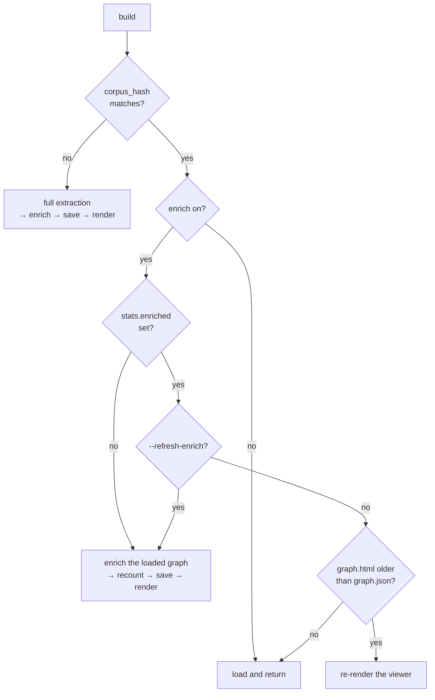

Three properties fall out:

1. **Turning enrichment on never triggers a re-extraction.** Structure is
   unchanged, so only the decoration runs — seconds, not minutes.
2. **The pass is resumable.** Anyone already carrying an `external` profile is
   skipped, so an interrupted run costs only what is still missing.
3. **Refreshing is explicit.** Citation counts move; the graph does not.
   `--refresh-enrich` is the "the numbers have changed" path.

### 21.4 Triggering it on demand

A profile can be missing because nothing matched on the day the graph was
built, or stale a year later — and neither is worth a rebuild. So enrichment is
also a **user-triggered action** on the exploration surface, not only a build
step:

```powershell
python -m crew.graph.interface --enrich "Marc Caron"   # one person, one request
python -m crew.graph.interface --enrich                # fill in whatever is missing
python -m crew.graph.interface --enrich --refresh-enrich   # re-fetch everyone
```

In the REPL: `/enrich <name>`, `/enrich`, `/refresh`.

`run_enrichment()` mutates the loaded graph, calls `recount_stats()`, and
persists to `graph.json`. A named person is re-fetched even if a profile is
already there — "refresh this one" is the whole point of naming them. The
viewer is picked up by the next `build`, which notices the HTML is older than
its source.

### 21.5 What it writes, and the consistency rule

For each matched author: `external` (source, OpenAlex id, ORCID, display name,
works/citation counts, h-index, institutions with ROR + country, topic tags).

Beyond that, a ROR-backed institution is **better evidence than a PDF header**,
so it is folded into the graph proper rather than left inside `external`: an
`Institution` node, a roster entry, a membership on the scientist, **and an
`AFFILIATED_WITH` edge**.

That last item matters more than it looks. The node lists and the edge list
must agree — the viewer takes its nodes from `scientist["institutions"]` but
its lines from `edges`, so an institution added to one and not the other
renders as an unconnected hub, and shows up isolated in `graph.nx`. Writing the
edge is what keeps the two views of the graph the same graph.

For the same reason, mutating a graph that `_Builder.finish()` already froze
invalidates its counts, so `ScientistGraph.recount_stats()` recomputes every
derived total and drops the caches built from the old edge list (`nx`, the
co-authorship projection, profile vectors). `stats` is what the CLI, the viewer
header and `summary()` all read; a stale count is a wrong number on every
surface.

### 21.6 Results on the real corpus

| Metric | Value |
|---|---|
| Corpus authors matched | **36 / 36** |
| With an ORCID | **25 / 36** |
| With an OpenAlex institution | **33 / 36** |
| Institutions before → after | **19 → 45** |
| `AFFILIATED_WITH` edges before → after | **36 → 62** |
| Requests | 36, at ~0.15 s apart (well under the ~10/s limit) |

Spot-checked: Marc Caron → Duke, h-index 175; Roy Wise → NIH, h-index 96;
Wolfram Schultz → Cambridge, h-index 94, ORCID `0000-0002-8530-4518`.

One result illustrates the limitation the pass is meant to *fix* rather than
one it introduces: a corpus author named `Jing Wu` matched a profile with
h-index 104 at Xijing Hospital. Surname agreement is satisfied; whether it is
the same person is exactly what a common Chinese name cannot settle without an
ORCID. The honest reading is that enrichment raises confidence for
distinctively-named researchers and leaves the hard cases hard.

---

## 22. GraphRAG — answering in natural language

`GraphCrew.ask()` is the graph's equivalent of `DopamineCrew.ask()`, and the
retrieval half is where "GraphRAG" is literal: instead of embedding-matched
passages, the retrieved context is a **subgraph** — a person's institutions,
interests, papers, collaborators and scored recommendations — serialised into
evidence lines.

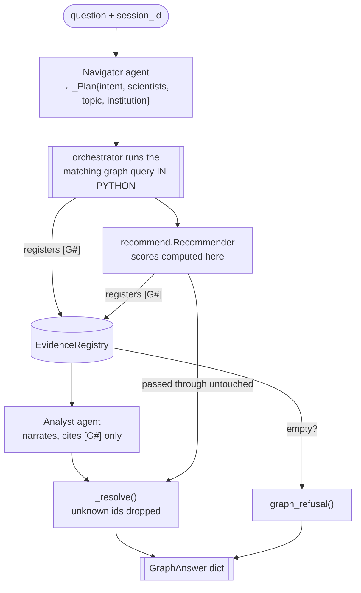

### 22.1 Seven intents, each a different query

`profile` · `connections` · `recommend` · `topic` · `institution` · `compare` ·
`overview`. The Navigator is shown a sample of known scientist names and the
full topic list so it extracts entities that exist, then the orchestrator runs
the matching lookup and registers each fact.

Two details worth noting. A topic or institution query registers **one line per
notable person** as well as the roster summary, so affiliations are actually in
evidence rather than merely present somewhere in the graph. And rosters are
ranked corpus-authors-first, because those are the people with affiliations — a
"who works on X and where" question can only be answered from them.

### 22.2 The grounding guarantee, again

Identical mechanism to [§7](#7-the-grounding-guarantee), different id prefix.
The Analyst receives `[G1] … [G7]` and may cite only those; `_resolve()` rebuilds
`sources` from the registry, so an invented `[G9]` is silently dropped rather
than becoming a fake citation. `tests/test_graph_grounding.py` asserts both
that and the stronger property: **recommendation scores pass through
untouched**, because they never enter the model's output schema in the first
place.

`GraphAnswer` is deliberately shaped like `CrewResponse` — same
`sources`/`claims` traceability contract — so both surfaces can be consumed by
the same client code.

### 22.3 Everything degrades to offline

| Component | Without an API key |
|---|---|
| Intent + entities | `_heuristic_plan()` — keyword rules + capitalised-run name detection |
| Narration | `_fallback_answer()` — a deterministic bulleted list built from the registry |
| Taxonomy | `SEED_TAXONOMY` |
| Reference parsing | `_heuristic_references()` — conservative; recovers authors, leaves titles empty |
| Front matter | Empty `PaperMeta` (and a warning) |
| Recommendations, lookups, viewer | Fully functional — they never needed a model |

The structured CLI paths (`--who`, `--recommend`, `--topic`, `--stats`) are pure
graph queries. Only the natural-language path calls Claude.

---

## 23. The viewer

`crew/.graph/graph.html` — one self-contained file, no CDN, no server, no build
step. Open it from disk.

Three decisions shape it:

**Layout is computed in Python, not the browser.** `networkx.spring_layout`
runs once at export with `seed=42`, so the map is deterministic: the same graph
always draws the same shape, reopening does not reshuffle everyone, and there
is no physics loop burning CPU while you read. Spacing scales as
`k = 1.6/√n` so density stays readable at 50 nodes or 600.

**Only a legible core is drawn.** The full citation graph is 3,640 people,
which renders as a grey hairball that answers no question. `_select_nodes()`
takes corpus authors, then everyone they co-authored with, then the most-cited
remainder up to `max_nodes` (default 600) — and the header says so. `graph.json`
still holds everything for programmatic use.

**Canvas, not SVG.** A few thousand DOM nodes make pan and zoom stutter; one
canvas stays smooth, and hit-testing a click against node positions is a loop
rather than a layout engine.

Recommendations are **baked in at export time**, with the embedder passed
through so the profile-similarity signal stays alive — without it a quarter of
every score would silently read zero. Click any node for its profile,
interests, papers, collaborators, scored recommendations with their per-signal
breakdown, and the PDF pages backing them. Search, filter by node kind, pan,
zoom, light and dark themes.

`CO_AUTHORED` edges are stored both ways but drawn once (`if src > tgt:
continue`); `CITES` is excluded from this view.

Because the viewer is one large template string, `tests/test_graph_viz.py`
guards the failure mode that matters: a broken brace produces a blank page
rather than an exception. It asserts layout reproducibility, tag balance, both
theme overrides, and that a `</script>` inside a paper title cannot break out
of the JSON payload.

---

## 24. Graph testing, costs and limitations

### 24.1 Testing

```
151 passed, 1 skipped in 22.76s      # whole suite, both subsystems
```

**120 of those 152 tests cover the graph**, across eight files, and need **no
API key, no network, and no built graph**:

| File | Tests | Covers |
|---|---:|---|
| `test_graph_canon.py` | 29 | Name parsing on strings taken verbatim from the nine PDFs — getting one wrong silently splits or merges a real researcher |
| `test_graph_enrich.py` | 24 | Surname guard, offline degradation, the affiliation edge, resumability, the on-demand trigger, stats recounting |
| `test_graph_extract.py` | 11 | Leniency on model output — a strict schema deletes a paper's whole author team |
| `test_graph_grounding.py` | 8 | Invented `[G#]` ids dropped; recommendation scores pass through untouched |
| `test_graph_recommend.py` | 15 | Ranking, exclusion and IDF weighting against a synthetic 6-person graph |
| `test_graph_store.py` | 14 | Persistence round-trip, fuzzy lookup, the co-authorship projection |
| `test_graph_topics.py` | 10 | Alias word boundaries (`D2` ∉ `D20`); a flat similarity profile selects *nothing* rather than everything |
| `test_graph_viz.py` | 9 | Layout reproducibility, tag balance, theme overrides, `</script>` injection |

The principle from [§10.2](#102-the-principle-test-what-is-deterministic)
carries over: test what is guaranteed by code, not by a language model. Every
network call in `test_graph_enrich.py` is patched — the tests assert the
*guards*, not OpenAlex.

### 24.2 Costs

| Layer | Cost |
|---|---|
| Front matter (9 papers) | 9 × Haiku calls, ~3k output tokens each |
| Reference lists | ~2–5 Haiku calls per paper (9,000-char batches) |
| Taxonomy derivation | 1 × Haiku call, once — then cached |
| Topic assignment | **$0** — local embeddings |
| Recommendation scoring | **$0** — pure Python + local embeddings |
| Viewer export | **$0** |
| OpenAlex enrichment | **$0** — no API key, 100k requests/day, CC0 |
| GraphRAG question | 2 × Opus calls (Navigator + Analyst) |

Extraction runs on `GRAPH_EXTRACT_MODEL` (default `claude-haiku-4-5`) because
bulk bibliography parsing is a *parsing* job, not a reasoning one — the same
model-tiering argument the scope guardrail makes in
[§5](#5-the-scope-guardrail). A full build is roughly **$1–2**; `--no-refs` is
about a tenth of that. Every subsequent run is free until the corpus changes.

### 24.3 Known limitations

| Limitation | Impact | Fix |
|---|---|---|
| **Names resolve on surname + first initial** | Two distinct `Wang D.` merge into one node | ORCID via enrichment; this is the standard bibliometric heuristic without it |
| A person cited as `Maknoon Razia D` and printed as `Dur E Maknoon Razia` may split | Duplicate nodes for compound surnames | Alias clustering, or ORCID |
| **Affiliations are ~1% covered without enrichment** | A cited-only researcher has no institution to record | `--enrich-all` fills these from OpenAlex |
| Enrichment can match the wrong person for common names | A plausible but wrong h-index | Match on ORCID or DOI-linked works, not on name search |
| Topics come from titles for cited works | Coarser interests than corpus authors get from abstracts | Fetch abstracts via OpenAlex/Crossref |
| Co-citation is over nine citing papers | A coarse signal — deliberately weighted lowest | More corpus papers |
| Reference extraction quality varies | Two-column PDFs interleave entries; some are dropped | Layout-aware extraction (e.g. GROBID) |
| `graph.json` is ~18 MB and loaded whole | Fine at this size; not a serving format | Postgres/Neo4j past ~10⁵ nodes; `ScientistGraph` is the seam |
| **No recommendation eval set** | Ranking changes cannot be shown to be improvements | Hold-out link prediction: hide known co-authorships, measure recall@k |

That last row is the one to fix first if this goes anywhere serious. It is the
same gap [§14.3](#143-scale-up-order) flags as lever #0 for the retrieval
layer, and for the same reason: **nothing below it can be justified without
it.** Every weight in [§20.1](#201-four-signals) is currently a considered
guess.

### 24.4 Decision log — graph

Continuing the numbering from [§11](#11-decision-log-with-rejected-alternatives).

| # | Decision | Chosen | Rejected | Rationale |
|---|---|---|---|---|
| 19 | Bibliography parsing | Cheap LLM (`claude-haiku-4-5`) | A regex per citation style | Nine papers, nine styles, two-column interleaving — the brittle work an LLM removes. It returns surface forms only |
| 20 | Entity resolution | Deterministic Python (`canon.py`) | Let the LLM decide who is who | Must be stable across rebuilds and unit-testable; a model could silently re-partition the graph between runs |
| 21 | Person id | surname + first initial | Full-name string match | The field's standard heuristic without ORCIDs. Full-string matching splits one person across five citation styles |
| 22 | Topic vocabulary | LLM-derived once, then **cached** | Re-derive every build | Topic ids *are* node ids — re-deriving would re-partition everyone's interests on a build that changed nothing |
| 23 | Topic assignment | z-scored cosine + exact alias hits | Fixed cosine threshold | Every topic here is a kind of dopamine research, so a fixed cutoff admits them all — an early build tagged the Parkinson's review as "Schizophrenia" |
| 24 | Recommendation scoring | Pure Python, four weighted signals | Ask a model who should meet whom | Numbers must not drift with model mood; and every score arrives with a defensible per-signal breakdown |
| 25 | Link prediction structure | Undirected co-authorship projection | Adamic-Adar on the full multigraph | Undefined on mixed-kind graphs; over institution nodes it makes everyone at one university a "collaborator" |
| 26 | Co-citation source | `CITES` edges | Name co-occurrence in a paper | Front-page authors aren't cited by their own paper — co-occurrence made every co-author look co-cited |
| 27 | Graph storage | One JSON file + NetworkX at load | Neo4j / a graph DB | 3.6k nodes, 44k edges — an in-memory dict is instant. The on-disk format never depends on a library version |
| 28 | External source | **OpenAlex** | Google Scholar, paid Scholar APIs | No public API and ToS prohibits automation; OpenAlex is CC0, keyless, and exposes ORCID + ROR, which is what the graph actually needs |
| 29 | Enrichment default | **On** | Off, opt-in via `--enrich` | Additive and incapable of failing loudly — a no-network build is byte-identical to the pre-enrichment graph. Off by default just meant nobody got ORCIDs |
| 30 | Enrichment vs. `corpus_hash` | Outside it | Fold it into the hash | It decorates nodes rather than creating them; hashing it would make "turn enrichment on" cost a full re-extraction |
| 31 | Enrichment trigger | Build step **and** on-demand CLI | Build only | A profile can be missing or a year stale; neither is worth a rebuild |
| 32 | Match acceptance | Require surname agreement | Take `results[0]` | OpenAlex ranks by relevance, not identity — a confident near-miss staples someone else's h-index onto a profile |
| 33 | Viewer layout | Precomputed in Python, fixed seed | Browser-side force simulation | Deterministic map, no physics loop; and the export already has NetworkX loaded |
| 34 | Viewer rendering | Canvas | SVG / DOM nodes | A few thousand DOM nodes make pan and zoom stutter |
| 35 | Viewer scope | Legible core, `max_nodes=600` | Draw all 3,640 | The full graph renders as a grey hairball that answers no question; `graph.json` still holds everything |

---

## Appendix: quick reference

**Entry points — Part I, the Q&A crew**

```powershell
python -m crew.build_index            # build / refresh the index
python -m crew.build_index --force    # force a full rebuild
python -m crew.interface              # interactive REPL
python -m crew.interface -q "..." --json
python -m pytest                      # test suite (both subsystems)
```

**Entry points — Part II, the scientist graph**

```powershell
python -m crew.graph.build                      # build (front matter + refs + OpenAlex)
python -m crew.graph.build --no-refs            # corpus authors only — fast
python -m crew.graph.build --force              # rebuild, re-derive the taxonomy
python -m crew.graph.build --no-enrich          # no network calls at all
python -m crew.graph.build --enrich-all         # enrich cited researchers too
python -m crew.graph.build --refresh-enrich     # re-fetch existing profiles

python -m crew.graph.interface --stats
python -m crew.graph.interface --who "Wolfram Schultz"
python -m crew.graph.interface --recommend "Josh Berke"
python -m crew.graph.interface --similar "Marc Caron"
python -m crew.graph.interface --topic "Parkinson"
python -m crew.graph.interface --institution "Duke"
python -m crew.graph.interface --enrich "Marc Caron"   # on-demand OpenAlex refresh
python -m crew.graph.interface --viz                   # open the map
python -m crew.graph.interface -q "Who should Marc Caron collaborate with?"
```

REPL: `/who` `/rec` `/similar` `/topic` `/inst` `/enrich [name]` `/refresh`
`/stats` `/viz` `/json` `/quit`.

**Key constants — retrieval**

| Constant | Value | Location |
|---|---|---|
| `chunk_chars` / `chunk_overlap` | 1200 / 200 | `config.py` |
| `top_k` | 6 | `config.py` |
| `rrf_k` | 60 | `config.py` |
| `scope_threshold` | 0.28 (env) | `config.py` |
| `GRAY_BAND` | 0.06 | `scope.py` |
| `GUARD_MODEL` | `anthropic/claude-haiku-4-5` | `scope.py` |
| `max_turns` | 8 messages | `memory.py` |
| snippet cap | 400 chars | `rag.py` |
| memory message cap | 500 chars | `memory.py` |
| Brave `max_results` | 5 | `tools.py` |

**Key constants — graph**

| Constant | Value | Env | Location |
|---|---|---|---|
| `graph_extract_model` | `claude-haiku-4-5` | `GRAPH_EXTRACT_MODEL` | `config.py` |
| `graph_batch_chars` | 9000 | `GRAPH_BATCH_CHARS` | `config.py` |
| `graph_min_mentions` | 1 (no pruning) | `GRAPH_MIN_MENTIONS` | `config.py` |
| `graph_topic_z` | 1.1 | `GRAPH_TOPIC_Z` | `config.py` |
| `graph_topic_threshold` | 0.20 | `GRAPH_TOPIC_THRESHOLD` | `config.py` |
| `graph_enrich` | **True** | `GRAPH_ENRICH` | `config.py` |
| `graph_enrich_all` | False | `GRAPH_ENRICH_ALL` | `config.py` |
| `rec_w_topic` / `_profile` / `_graph` / `_citation` | 0.35 / 0.25 / 0.25 / 0.15 | `REC_W_*` | `config.py` |
| `rec_same_institution_penalty` | 0.10 | `REC_SAME_INST_PENALTY` | `config.py` |
| evidence snippet cap | 300 chars | — | `graph/schema.py` |
| viewer `max_nodes` | 600 | — | `graph/viz.py` |
| layout seed | 42 | — | `graph/viz.py` |
| OpenAlex delay | 0.15 s | — | `graph/enrich.py` |

**Credentials**

| Variable | Required for | Without it |
|---|---|---|
| `ANTHROPIC_API_KEY` | Synthesis, extraction, GraphRAG narration | Refusals, retrieval, graph lookups, recommendations and the viewer all still work; extraction falls back to heuristics |
| `BRAVE_SEARCH_API_KEY` | The web-search path | Clean "web unavailable", paper-only answers |
| *(none)* | **OpenAlex enrichment** | — it needs no key |

**Git-ignored runtime artifacts**

```
crew/.env                 secrets
crew/.index/              faiss.index · chunks.json · manifest.json
crew/.papers/*            the nine PDFs  (SOURCES.md is committed)
crew/.memory/             sessions.sqlite3
crew/.graph/              graph.json · graph.html · taxonomy.json
```
